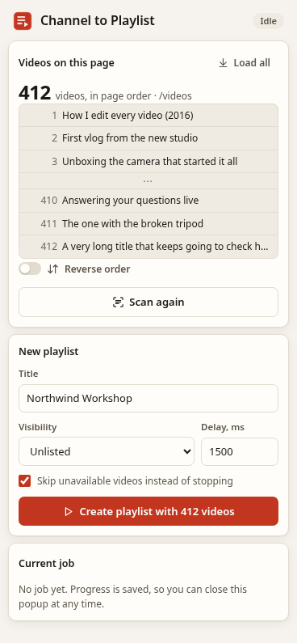
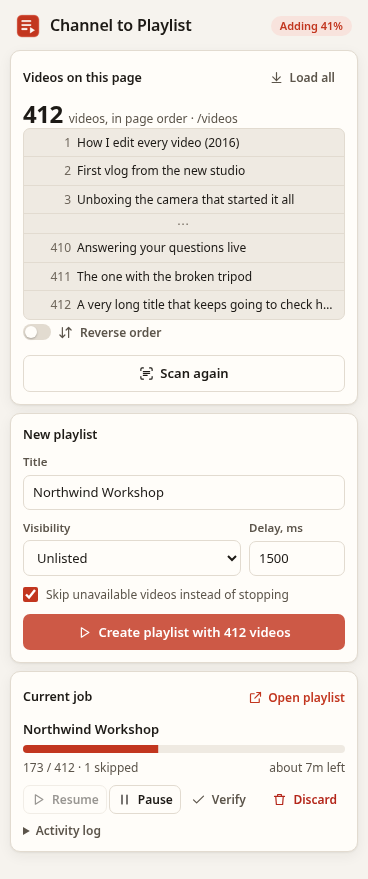
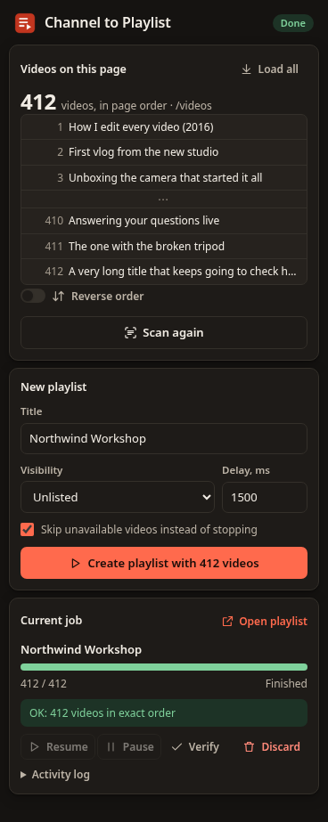

# Channel to Playlist

A small Chrome extension that turns a YouTube channel's video list into a playlist, **in the same order you see on the page**.

Open a channel's **Videos**, **Live** or **Shorts** tab, pick a sort order (for example *Oldest*), scroll until the videos you want are loaded, then click **Create playlist**. The playlist is named after the channel by default.

| Scanned | Adding videos | Done (dark) |
|---|---|---|
|  |  |  |

> **Unofficial.** This project is not affiliated with, endorsed by, or connected to YouTube or Google. It uses YouTube's internal web API (the same requests youtube.com makes) with **your own signed-in session** in your own browser. YouTube can change this API at any time, and the extension may stop working without notice. Use at your own risk and within YouTube's Terms of Service.

## Features
- Scans the videos currently loaded on the page, in page order. Duplicates removed; ads, playlists and other non-video tiles skipped.
- Preview with count and the first and last titles. Optional **Reverse order**.
- **Load all**: scrolls the page until no more videos load. You can stop it any time.
- Editable title (defaults to the channel name) and visibility: Unlisted (default), Private or Public.
- Adds videos one at a time, with a configurable delay (1500 ms by default, with random jitter), retries and exponential backoff.
- Progress, ETA, pause and resume. The job (playlist ID, scanned ID list, position) is saved in `chrome.storage.local`, so it survives closing the popup, reloading the tab, or restarting the browser.
- **Verify** compares the playlist on YouTube with the scanned list.
- Light and dark themes, keyboard accessible, honors reduced motion.
- Permissions: `storage` and `https://www.youtube.com/*` only. No servers, analytics or third-party requests.

## Install from source
1. Download or clone this repository.
2. Open `chrome://extensions`, turn on **Developer mode**, click **Load unpacked**, and select the repository folder.
3. **Reload any YouTube tabs that were already open.** The extension only attaches to pages loaded after it is installed.

Works in Chrome and other Chromium browsers that support Manifest V3 with `world: "MAIN"` content scripts (Chrome 111+).

## Use
1. Sign in to YouTube. In YouTube settings, make sure **"Add new videos to top of playlist" is off**, or the playlist will come out reversed.
2. Open a channel tab such as `youtube.com/@handle/videos`, `/streams` or `/shorts` and choose the sort.
3. Scroll until every video you want is loaded, or click **Load all**.
4. Open the extension and click **Scan page**. Check the count and preview.
5. Adjust the title and visibility, then click **Create playlist**.
6. Keep a YouTube tab open while it runs. You can browse YouTube in that tab; if the tab reloads, click **Resume**.

Only one job runs at a time. If you start a new one while another is unfinished, the popup asks whether to discard it or keep it.

## Limits and caveats
- A YouTube playlist holds at most **5,000 videos**. Only the first 5,000 scanned videos are used.
- YouTube appears to limit how many videos an account can add per day. If adds keep failing with rate or quota errors, the job stops; click **Resume** later (for example the next day).
- Unavailable or private videos are skipped (you can turn that off to stop instead) and listed in the activity log. YouTube also hides them on the playlist page, so Verify accounts for them.
- The scanner depends on YouTube's page markup, which changes often. If a scan finds no videos, or the wrong number, reload the tab and try again, and please open an issue.
- The default pace is about 40 videos per minute, so 1,000 videos take roughly 25 minutes.

## How it works
- `extract.js` reads the channel grid in the page (`ytd-rich-item-renderer`, `yt-lockup-view-model`, shorts lockups and older grid renderers) and takes the video ID from each `/watch?v=` or `/shorts/` link, falling back to every such link in the grid.
- `page.js` runs in the page's own JavaScript world, reads YouTube's client config (`ytcfg`), and sends InnerTube requests (`playlist/create`, `browse/edit_playlist` with `ACTION_ADD_VIDEO`, `browse`) with a `SAPISIDHASH` authorization header built from your session cookie (`sapisid.js`).
- `runner.js` runs the job: create once, add one at a time, back off on errors, save progress after every video.
- `content.js` connects the popup, the scanner and the runner. `popup.*` is the UI.

Nothing leaves your browser except requests to `www.youtube.com`.

## Development
```
cd tests && npm install && npm test
```
Tests cover the DOM extractor (jsdom fixtures for lockup, legacy and shorts markup, ads, duplicates, hidden SPA pages) and a mocked job run (pause and resume, retry on HTTP 429, skipping unavailable videos, verify).

`tools/screenshots.sh` renders the popup with mocked states in headless Chrome to regenerate `docs/`.

## License
[MIT](LICENSE) © 2026 Hubert Gavin
